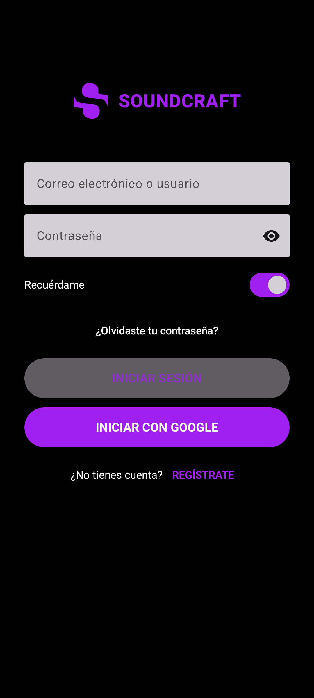
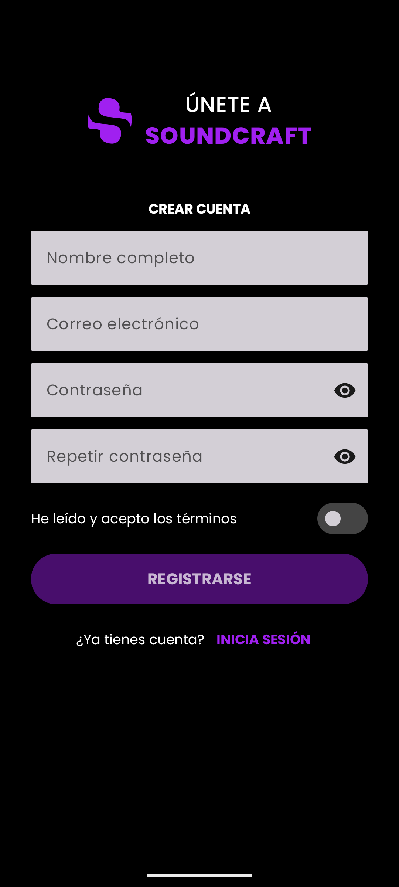

# SoundCraft

Portafolio de recursos sonoros y musicales para almacenar, clasificar y recuperar
rápidamente. Hecho con **Kotlin, Jetpack Compose, Material 3 y MVVM con StateFlow**.

Requerimientos completos en [requerimientos.md](requerimientos.md) · Diseño UI en
[ingenieria/diseno_ui.webp](ingenieria/diseno_ui.webp).

## Cómo ejecutarla
1. Clonar el repo con GitHub Desktop y abrir la carpeta `SoundCraft` en **Android Studio**.
2. Esperar a que termine el *Gradle sync* (abajo a la derecha).
3. Elegir un emulador o un teléfono conectado y presionar **Run ▶**.
4. Para ver las pantallas sin emulador: abrir `LoginScreen.kt`, `RegisterScreen.kt`
   o `ForgotPasswordScreen.kt` y usar la vista **Split / Design** (los `@Preview`).

> La autenticación es **simulada**: entra cualquier correo con formato válido y una
> contraseña de 6 o más caracteres.

## Módulo de autenticación
| Pantalla | Qué hace |
|---|---|
| Login | Correo, contraseña con ojo, "¿Olvidaste tu clave?", "Regístrate". El botón se habilita solo con datos válidos. |
| Registro | Nombre, correo, contraseña, repetir clave y términos. Validación en vivo. |
| Recuperar clave | Correo + "Enviar enlace". Confirma con un Dialog y vuelve al login. |
| Inicio (provisorio) | Muestra el usuario y permite cerrar sesión. |

Estados de la UI (`AuthUiState`): `Idle`, `Loading` (círculo de carga), `Success`, `Error`.

### Capturas
<!-- Reemplazar por capturas reales del emulador o de los @Preview -->
| Login | Registro | Recuperar clave |
|---|---|---|
|  |  |  |

## Estructura
```
app/src/main/java/com/example/soundcraft/
├── MainActivity.kt                 punto de entrada
├── navigation/AuthNavigationGraph.kt   rutas y NavHost
└── ui/
    ├── auth/      AuthUiState, AuthViewModel, Login, Register, ForgotPassword
    ├── home/      Inicio provisorio
    ├── components/ logo, campos de texto y botón principal
    └── theme/     colores y tema oscuro
```

## Bitácora de prompts e IA
| ID | Objetivo | Asistente | ¿Compiló al 1er intento? | Auditoría humana (errores, alucinaciones, cambios manuales) |
|---|---|---|---|---|
| P1 | `AuthUiState` + `AuthViewModel` con StateFlow y validación (Regex email, mín. 6) | Claude (Claude Code) | Sí | Se separaron `esEmailValido`/`esPasswordValida` para validar en vivo desde la UI. Se agregaron pruebas unitarias. |
| P2 | Tema oscuro SoundCraft a partir del diseño | Claude (Claude Code) | Sí | Se usó el violeta del logo como color principal en lugar del azul #2563EB de la guía, para respetar la identidad de SoundCraft. |
| P3 | `LoginScreen` y `RegisterScreen` en Compose | Claude (Claude Code) | Sí | Se dividió cada pantalla en `Screen` (con ViewModel) y `Content` (sin ViewModel) para que los `@Preview` funcionen (*state hoisting*). |
| P4 | `ForgotPasswordScreen` + `NavHost` | Claude (Claude Code) | Sí | Se usó un solo `AuthViewModel` compartido y `resetState()` al cambiar de pantalla, para que un error no aparezca en la pantalla siguiente. |

> **Equipo:** completar la columna de auditoría con lo que ustedes revisaron y
> probaron en el emulador. Los prompts completos están en [bitacoras/](bitacoras/).
