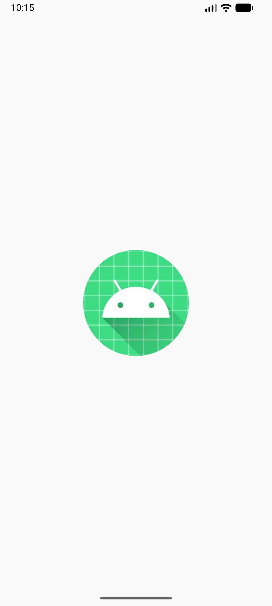
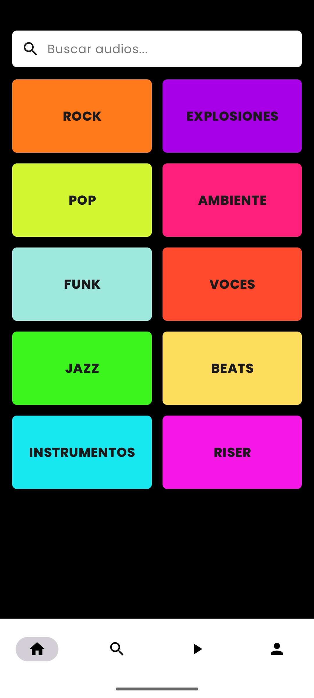
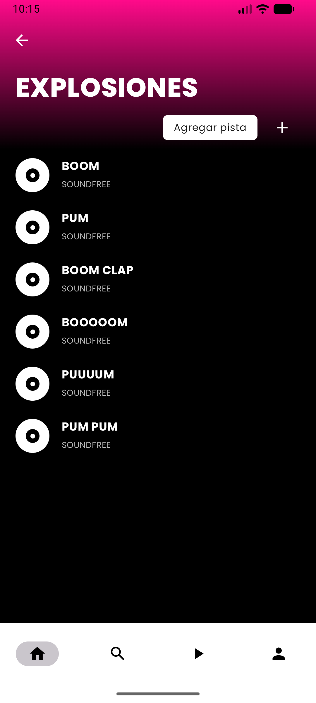
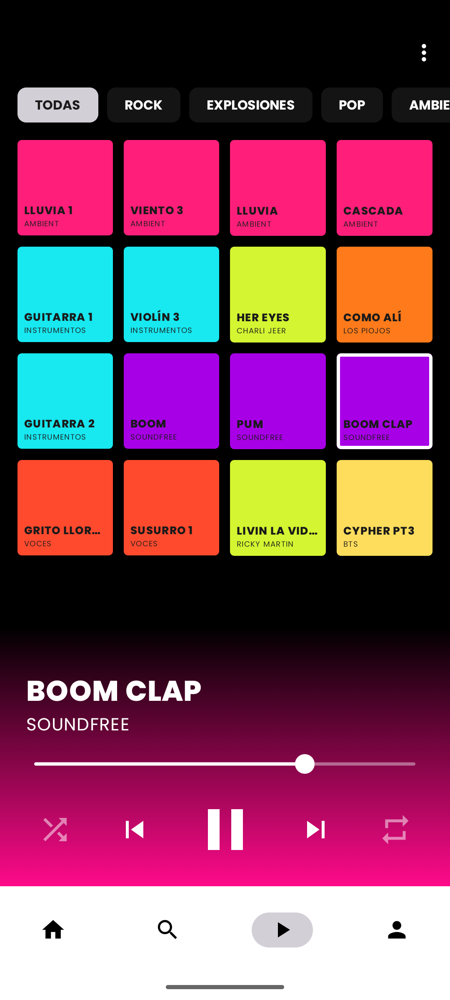
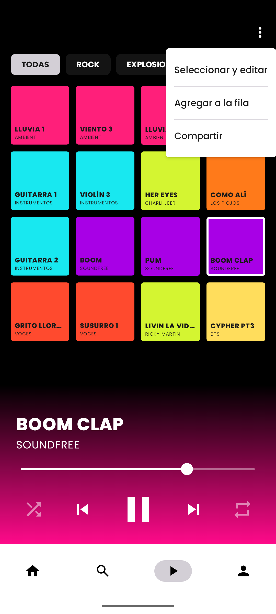
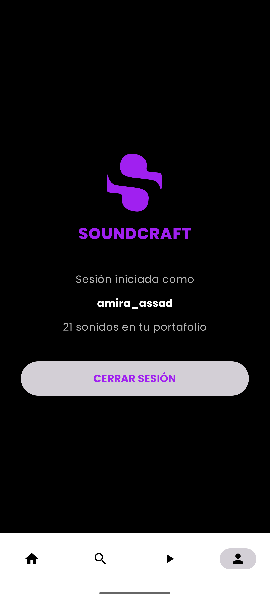

# SoundCraft

Portafolio de recursos sonoros y musicales para almacenar, clasificar y recuperar
rápidamente. Hecho con **Kotlin, Jetpack Compose, Material 3 y MVVM con StateFlow**.

Requerimientos completos en [requerimientos.md](requerimientos.md) · Diseño UI en
[ingenieria/diseno_ui_auth.jpg](ingenieria/diseno_ui_auth.jpg).

## Cómo ejecutarla
1. Clonar el repo con GitHub Desktop y abrir la carpeta `SoundCraft` en **Android Studio**.
2. Esperar a que termine el *Gradle sync* (abajo a la derecha).
3. Elegir un emulador o un teléfono conectado y presionar **Run ▶**.
4. Para ver las pantallas sin emulador: abrir cualquier archivo `...Screen.kt` y usar la vista
   **Split / Design** (los `@Preview`).

> Es un **prototipo navegable**: el inicio de sesión es simulado (entra cualquier correo
> válido o usuario de 3+ caracteres, con contraseña de 6+), los sonidos son datos de ejemplo
> en memoria y el reproductor todavía no reproduce audio.

## Flujo de la app
```
Splash → Login ─┬─ Registro
                ├─ Recuperar contraseña
                └─ (sesión iniciada) → Inicio · Buscar · Panel 4x4 · Perfil   ← barra inferior
                                         └─ Detalle de categoría (+ Agregar pista WAV/MP3)
```

## Módulo de autenticación
| Pantalla | Qué hace |
|---|---|
| Login | Correo o usuario, contraseña con ojo, "Recuérdame", "¿Olvidaste tu contraseña?", "Iniciar con Google" (próximamente) y "Regístrate". El botón se habilita solo con datos válidos. |
| Registro | Nombre, correo, contraseña, repetir contraseña y switch de términos. Validación en vivo. |
| Recuperar contraseña | Correo + "Enviar enlace". Confirma con un Dialog. "Volver al inicio" regresa al login. |

Estados de la UI (`AuthUiState`): `Idle`, `Loading` (círculo de carga), `Success`, `Error`.

| Login | Registro | Recuperar contraseña |
|---|---|---|
|  |  |  |

## Módulo de gestión de recursos
| Pantalla | Qué hace |
|---|---|
| Splash | Logo de SoundCraft al abrir la app. |
| Inicio | Barra "Buscar audios..." y grilla de 2 columnas con las 10 categorías. |
| Buscar | Filtra los sonidos por nombre, autor o categoría mientras se escribe. |
| Detalle de categoría | Encabezado rosa, lista de pistas y **Agregar pista**: abre el selector de archivos del teléfono filtrado a **WAV/MP3** y guarda solo ruta, nombre y categoría. |
| Panel 4x4 | 16 pads de colores, filtro por categoría, menú de tres puntos y reproductor (play/pausa, anterior, siguiente, aleatorio, repetir, barra de progreso). |
| Perfil | Usuario, cantidad de sonidos y "Cerrar sesión". |

Estados del catálogo (`CatalogoUiState`): `Cargando`, `Exito`, `Vacio`, `Error`.

| Splash | Inicio | Detalle |
|---|---|---|
|  |  |  |

| Panel 4x4 | Menú del panel | Perfil |
|---|---|---|
|  |  |  |

## Estructura
```
app/src/main/java/com/example/soundcraft/
├── MainActivity.kt                     punto de entrada
├── navigation/AuthNavigationGraph.kt   rutas principales y NavHost
├── data/                               Categoria, Pista y RecursosRepository (datos de ejemplo)
└── ui/
    ├── auth/        AuthUiState, AuthViewModel, Login, Register, ForgotPassword
    ├── recursos/    RecursosViewModel (catálogo y reproductor)
    ├── main/        MainScreen con la barra inferior
    ├── splash/ categorias/ buscar/ panel/ perfil/   una carpeta por pantalla
    ├── components/  logo, campos, botones, filas y estados (cargando/vacío/error)
    └── theme/       colores, tema oscuro y tipografía Poppins
```

Pruebas unitarias en `app/src/test`: validación de correo/usuario/contraseña y regla de solo WAV/MP3.

## Bitácora de prompts e IA
Los prompts 1 a 4 son los del docente (Caso de Uso, diapositivas 5–7) con "AppSeminario" cambiado
por "SoundCraft". El texto completo de cada prompt está en [bitacoras/](bitacoras/).

| ID | Objetivo | Asistente | ¿Compiló al 1er intento? | Auditoría humana (errores, alucinaciones, cambios manuales) |
|---|---|---|---|---|
| P1 | `AuthUiState` + `AuthViewModel` con StateFlow y validación (Regex email, mín. 6) | Claude (Claude Code) | Sí | Validaciones públicas para validar en vivo desde la UI; pruebas unitarias; el login acepta correo o usuario (como pide el diseño). |
| P2 | `LoginScreen` | Claude (Claude Code) | Sí | Separado en `Screen` + `Content` para usar `@Preview` (*state hoisting*); `TextField` gris en vez de `OutlinedTextField` por el diseño. |
| P3 | `RegisterScreen` con validación activa | Claude (Claude Code) | Sí | Checkbox reemplazado por Switch y botón "REGISTRARSE", como en el diseño. |
| P4 | `ForgotPasswordScreen` + `NavHost` | Claude (Claude Code) | Sí | Un solo `AuthViewModel` compartido y `resetState()` al cambiar de pantalla. |
| P5 | Aplicar nuestro diseño y redibujar el logo "S" como vector | Claude (Claude Code) | Sí | Logo trazado a mano desde la imagen; violeta del logo en lugar del azul #2563EB de la guía; tipografía Poppins agregada. |
| P6 | Modelo de datos, repositorio y `RecursosViewModel` | Claude (Claude Code) | Sí | Datos en memoria (no Room todavía); categoría Jazz vacía a propósito para mostrar el estado "vacío". |
| P7 | Categorías, Buscar y Detalle con subir WAV/MP3 | Claude (Claude Code) | Sí | El filtro WAV/MP3 se valida dos veces: en el selector (tipo de archivo) y por extensión en el ViewModel. |
| P8 | Panel 4x4 con reproductor | Claude (Claude Code) | **No** | Error: importó `weight` de un paquete interno. Se borró ese import. Después se cambió la barra de progreso gruesa por una fina como el diseño. |
| P9 | Splash, Perfil y barra inferior | Claude (Claude Code) | Sí | El detalle de categoría marca la pestaña "Inicio" como activa. |

> **Equipo:** completar la columna de auditoría con lo que ustedes revisaron y probaron.
